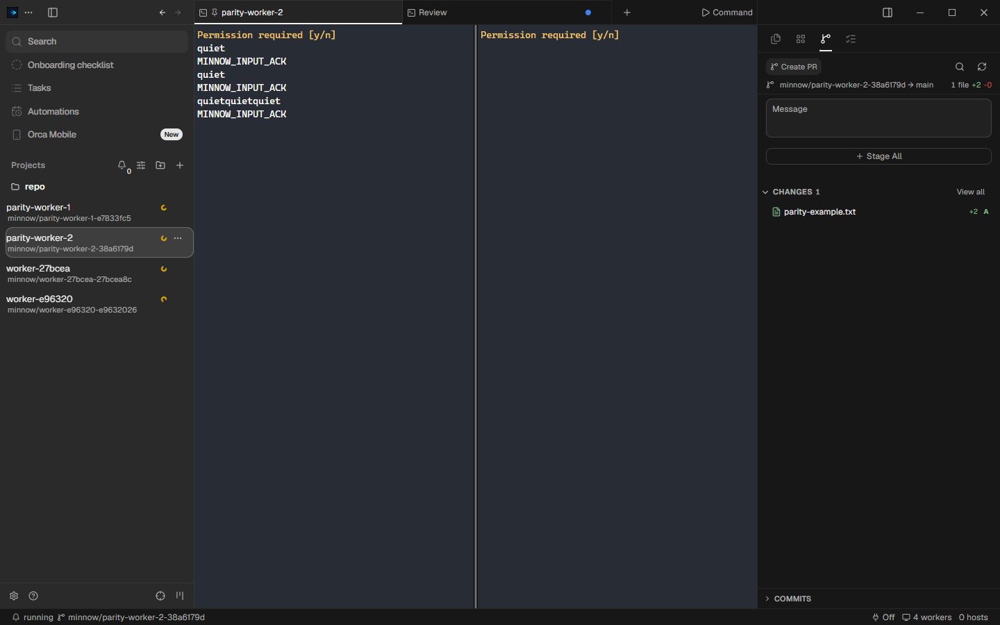

# Minnow

A Windows workspace for parallel [oh-my-pi](https://github.com/can1357/oh-my-pi) sessions.

Each worker gets its own Git worktree and native terminal. Arrange terminals in tabs and split panes, review changes, and merge a branch back without sharing a working directory.

Built with **Tauri 2, Rust, Svelte 5, and ConPTY**. No Electron. No UI component kit.

## What it does

- Add projects with the native folder picker, clone a repository, or create a new Git project.
- Type directly into any worker's real omp terminal, rendered by xterm.js with WebGL.
- See activity-based running, idle, waiting-for-input, and exited states, with Windows notifications on idle and exit.
- Restart or stop workers, open their worktrees in VS Code, inspect diffs, and merge or remove worktrees with Git safety checks.
- Recover active workers after an app restart using their saved omp sessions.
- Configure the omp executable and default worker count. Keep your existing omp providers, authentication, and tools.
- Use the Orca-style workspace shell, workspace search, tab menus, resizable panes, and Windows keyboard shortcuts.
- Switch between dark, light, and system themes; tune terminal typography, cursor, and pane titles.
- Browse workspace folders lazily, search file contents, and edit UTF-8 files with CodeMirror. Saves check the observed file revision and preserve Windows line endings.
- Review staged, unstaged and untracked changes; stage/unstage individual files or sections, commit staged changes and inspect actual commit history.



The interface ports Orca's MIT-licensed design to Svelte. [UI_PARITY.md](UI_PARITY.md) maps the source components, supported interactions, screenshot comparisons, and deliberate backend differences.

## Build on Windows

### Prerequisites

Windows 10 1809+ or Windows 11, Git, Node.js 22.12+ (or a supported newer LTS), Rust stable with the MSVC toolchain, Visual Studio C++ Build Tools with a Windows SDK, and Microsoft Edge WebView2 Runtime. Install omp separately and verify `omp --help` works. Minnow launches the native `omp.exe` distribution.

PowerShell setup for Rust and C++ tools:

```powershell
winget install -e --id Rustlang.Rustup --accept-package-agreements --accept-source-agreements
winget install -e --id Microsoft.VisualStudio.2022.BuildTools --accept-package-agreements --accept-source-agreements --override "--wait --passive --add Microsoft.VisualStudio.Workload.VCTools --includeRecommended"
```

Open a new PowerShell after installing tools, then:

```powershell
git clone https://github.com/hanphanr1/Minnow.git
Set-Location Minnow
npm.cmd ci
npm.cmd run desktop
```

Release executable, without an installer:

```powershell
npm.cmd run release
.\src-tauri\target\release\minnow.exe
```

If the current shell cannot find a newly installed Cargo:

```powershell
$env:Path = "$env:USERPROFILE\.cargo\bin;$env:Path"
```

Release builds enable LTO, a single codegen unit, symbol stripping, size optimization, and abort-on-panic. Builds use two Cargo jobs to limit peak compiler memory.

### Checks

```powershell
npm.cmd run check
npm.cmd run build
Push-Location src-tauri
cargo check --locked
cargo test --lib --locked
Pop-Location
```

The Windows workflow runs these checks and builds a release artifact. Desktop interaction and memory measurements are separate from compilation checks.

### Application icons

`assets/icon/minnow-source.png` is the square PNG used to generate the Tauri icon set. The supplied original is preserved at `assets/icon/minnow_source.png`; its contents are JPEG despite the original extension. It is already 1408 × 1408, so no padding or stretching was needed. Future non-square sources should be centered on a square `#0c0e10` canvas before generation.

```powershell
npm.cmd run tauri -- icon assets/icon/minnow-source.png
```

The Tauri configuration lists the generated PNG, ICO, and ICNS assets. Windows embeds `icon.ico` in `minnow.exe` and uses the generated app icon for its window and taskbar.

## Workflow

1. **Add a project.** Browse to a local Git repository, enter its path, clone a repository into a parent folder, or create a new project. Existing repositories need an initial commit and checked-out branch. New projects use your Git identity for their initial commit; no identity or signing configuration is invented.
2. **Create workers.** Choose a name and count. Worktrees live at `<repo>/.minnow/worktrees/<name>`; each worker has a dedicated session directory at `<repo>/.minnow/sessions/<id>`.
3. **Work in parallel.** Switch tabs with Alt+1…9 or Ctrl+PageUp/PageDown. Split right with Ctrl+Shift+D or down with Alt+Shift+D. Each new terminal creates another worker/worktree. Hidden terminals keep running but release their browser-side terminal resources.
4. **Review and merge.** Use Explorer/Search to open and edit real files. Source Control separates staged, unstaged and untracked changes; commits include only the index. Stop the worker before merging. Both trees must be clean and the base checkout must be on the captured target branch.
5. **Remove finished workers.** Deletion refuses dirty worktrees, including ignored files, and branches not merged into the base. Session history is retained.

VS Code's `code` launcher must be on PATH. Diffs cover committed and working-tree changes relative to the worker's creation commit, including untracked files. Git output and displayed diffs are bounded to 2 MiB; inspect larger changes directly with Git.

Closing Minnow terminates its owned worker process trees and records which workers should resume. Reopening it relaunches those workers in the same worktrees, using their dedicated session directories and `--continue` when saved sessions exist. Explicitly stopped or naturally exited workers remain stopped until Restart. Resume restores the omp session, not the original process or PTY.

## Memory model

- Rust owns PTYs and reads their output with blocking I/O. The frontend does not poll for terminal data.
- Each worker has a Rust output ring capped at **2 MiB**, allocated as output arrives.
- Visible output has a **64 KiB acknowledgement window**. A slow terminal renderer cannot accumulate an unlimited IPC queue.
- Only visible terminals allocate xterm and WebGL resources. xterm scrollback is bounded to 500 lines.
- Process exit uses a blocking wait. A one-second native supervisor checks inactivity.
- Explorer lists one directory at a time, capped at 1,000 entries. UTF-8 file reads, saves and displayed Git output are bounded to 2 MiB. Search caps hits at 500, candidate files at 20,000 and scanned text at 32 MiB; truncated results are labelled.
- One leased filesystem observer follows the visible workspace and its Git index. Change events are coalesced; the UI does not poll repository files or Git status.
- omp launches with `--motion none --spinner-interval 0 --no-title` to avoid animation and background title generation.

Tauri still uses WebView2 renderer, GPU, and utility processes. Four omp workers also have their own memory costs; measuring only `minnow.exe` would hide most of the total.

The four-worker RAM measurement has not been completed for this frontend. The <150 MiB target is a target, not a measured result. The UI parity work does not establish a memory or speed comparison with Orca.

### Reproduce a measurement

Launch the release build, create four real omp workers in a throwaway repository, and leave them idle. Use the application's actual PID:

```powershell
.\scripts\Measure-Ram.ps1 -RootPid 12345 -Samples 5 -IntervalSeconds 2 -OutputPath .\ram.json
```

The script records the full descendant process tree, including WebView2 and omp. Summed working sets count shared pages in each process. Private working set excludes shared pages; private commit is committed virtual memory, not resident RAM. The measuring PowerShell process is excluded.

## State and limitations

- SQLite stores projects, worker identities, merge bases, desired-running state and settings in the per-user local app-data directory for `com.minnow.app`. `MINNOW_DATA_DIR` isolates both SQLite and the WebView2 browser profile. One process owns a state directory at a time.
- `.minnow/` is added to the repository's local Git exclude, not its tracked `.gitignore`.
- Status is an observation, not a model completion signal: running means recent PTY activity; idle means at least three seconds of silence; waiting-for-input means a recognized prompt followed by silence; exited comes from the process wait result. A long silent request can appear idle, and unfamiliar prompts may not be recognized.
- Windows can suppress notification banners through Focus Assist or notification preferences. The unpackaged executable uses the notification crate's Windows PowerShell toast identity, with Minnow in the title. Notification clicks do not select a worker.
- The terminal ring is not durable scrollback. After truncation it may start partway through a screen update; after app restart, conversation recovery comes from omp's saved session instead. Hidden workers still execute.
- A conflicting merge is reported and the merge started by Minnow is aborted; the worker branch is retained. Resolve the branch conflict with Git before retrying. No forced reset or worktree removal is used.
- This release targets local Windows repositories and the native omp executable. It does not include remote hosts, WSL orchestration, multi-vendor agent launchers, or Orca's dispatch graph.
- Orca's browser, native chat, mobile, remote hosts, integrations, and other service-backed pages are labelled shell-only placeholders. No Electron or Orca service runs inside Minnow.
- Explorer/search/editing and local Git staging/commit/history now have real native APIs. File editing is limited to UTF-8 text; binary/oversized files produce an error. Conflicting external edits are not silently overwritten. Renaming/deleting files, Git discard/conflict-resolution UI and history paging remain incomplete.
- Native Browse folder, clone and create-project flows are implemented. Plain non-Git folders, provider issue/PR creation and arbitrary workspace base-branch selection remain incomplete. Clone uses your configured Git credentials; no token is embedded.
- Shortcut settings show Orca's Windows defaults, including excluded commands. Supported workspace/terminal bindings work; custom rebinding is unavailable.
- The published shell milestone is not full Orca parity. [UI_PARITY.md](UI_PARITY.md) tracks missing feature families separately from screenshot coverage; unavailable pages do not count as implemented features.
- Local workspace state and session files are not encrypted by Minnow. Provider credentials remain managed by omp.

## Architecture and reference

[REFERENCE.md](REFERENCE.md) traces Orca's worktree, PTY, status, notification, session, and layout implementations at a pinned revision. It distinguishes Orca's existing performance mitigations from source-level costs; it does not invent an Orca RAM comparison.

Minnow uses an independent Rust backend and a Svelte port of Orca's interface. Orca's MIT attribution and the bundled font/icon licenses are retained in [THIRD_PARTY_NOTICES.md](THIRD_PARTY_NOTICES.md).

## License

[MIT](LICENSE). Copyright 2026 [hanphanr1](https://github.com/hanphanr1).
